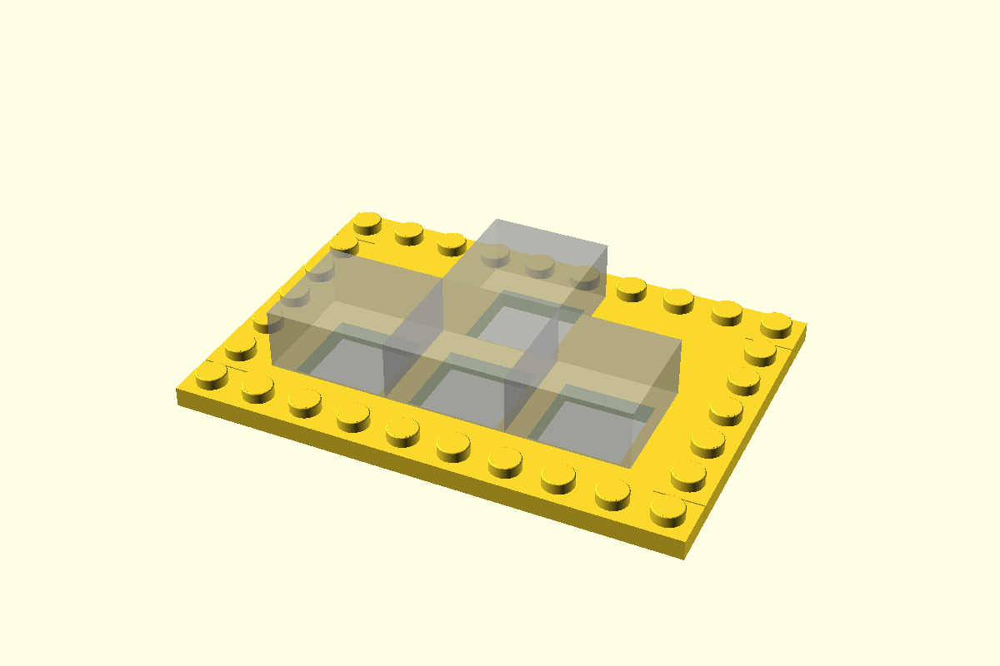
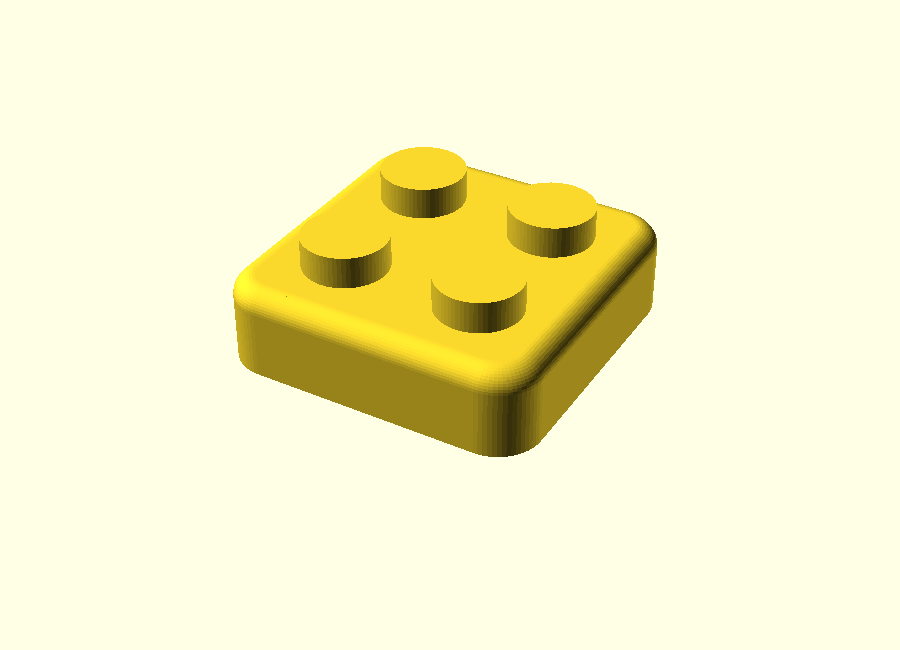
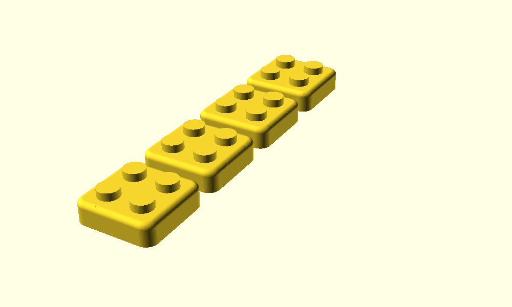
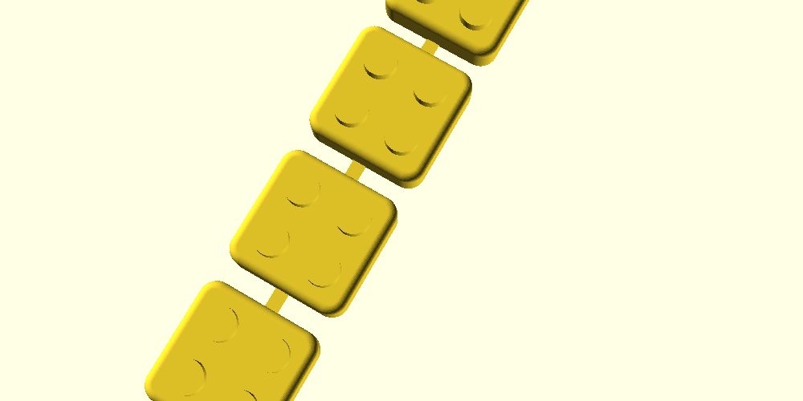
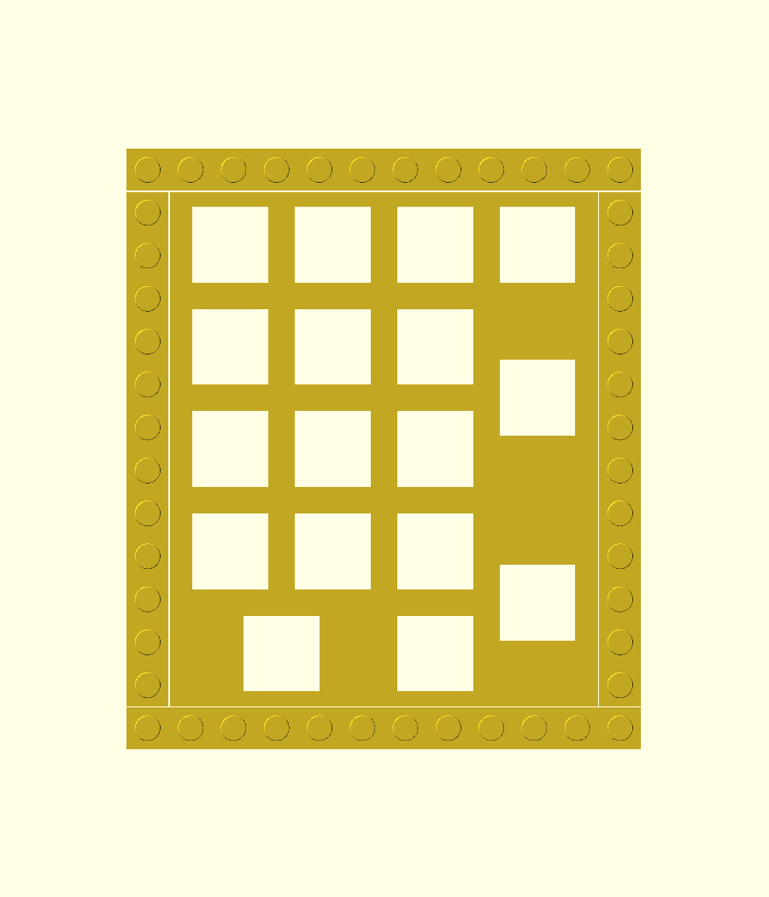

# KeyLego — tastiera LEGO (LegoPlate.scad + keyCaps.scad)

Progetto tastiera **compatibile LEGO**:

- **`LegoPlate.scad`** — piastra per tastiera generata dal layout JSON
  esportato da [editor.keyboard-tools.xyz](https://editor.keyboard-tools.xyz/):
  tasselli LEGO sul bordo, attacco femmina sotto, aperture per gli switch.
- **`keyCaps.scad`** — keycap compatibili Cherry MX con attacco **LEGO
  maschio** sulla faccia superiore: ogni tasto riceve mattoncini LEGO.

Il progetto si basa sulla libreria [LEGO.scad](https://github.com/cfinke/LEGO.scad)
(Christopher Finke, MIT), vendorsa in `LEGO.scad`.



## File

| File | Descrizione |
| --- | --- |
| `LegoPlate.scad` | Piastra: apertura tasti, anello tasselli, pareti di esempio |
| `keyCaps.scad` | Keycap Cherry MX + tasselli LEGO sopra |
| `LEGO.scad` | Libreria mattoncini LEGO (vendored) |
| `keyboard_layout.json` | Layout tastiera (formato KLE / keyboard-tools) |
| `layout_to_scad.ps1` | Converte il JSON in `keyboard_layout.scad` |
| `build.ps1` | Rigenera il layout ed esporta PNG/STL della piastra |
| `keyboard_layout.scad` | **Generato** — dati tasti `[x, y, w, h]` in 1u |
| `keyCaps.json` | Preset Customizer per i keycap (usabile con `-p`/`-P`) |
| `keycap_set.stl` | STL di esempio del set di keycap |
| `img/` | Render di esempio |

> Nota: la build di OpenSCAD installata (2026.11-RC0) non ha la funzione
> `import()` per i JSON (feature da snapshot di sviluppo), quindi il layout
> passa da un passaggio di conversione PowerShell.

## Workflow

1. Editi il layout su editor.keyboard-tools.xyz ed esporti il JSON
   (sovrascrivi `keyboard_layout.json`).
2. Rigeneri ed esporti:
   ```powershell
   powershell -File .\build.ps1 -Stl      # PNG + STL
   powershell -File .\build.ps1           # solo PNG
   ```
   In alternativa apri `LegoPlate.scad` in OpenSCAD (dopo aver rigenerato
   `keyboard_layout.scad` con `layout_to_scad.ps1`).

Il convertitore gestisce la semantica KLE: stringhe = tasti 1×1;
`{"w":n}`, `{"h":n}`, `{"x":n}` si applicano al tasto che segue
(es. `{"w":2},"0\nIns"`); numeri e booleani vengono ignorati.

## Come è fatta la piastra

- **Composta da 5 parti LEGO**: 4 mattoncini d'anello (fronte/retro/larghezza
  `margin_studs`) + il campo tasti centrale, tutti alti `plate_th`
  (min 3.2 mm = piastra LEGO).
- Dimensioni: estensione del layout in mm (`1u = 19.05`) + anello di margine
  di `margin_studs` tasselli per lato — è lì che si agganciano pareti e mattoncini.
- **SOPRA — tasselli solo al bordo**: gli anelli hanno i tasselli solo sul
  bordo; il campo tasti è privo di tasselli, così switch e tasti non
  incontrano ostacoli.
- **SOTTO — attacco femmina**: anello e campo tasti sono mattoncini a fondo
  aperto (cava con pareti e spline). Negli anelli ci sono anche pin/perni
  come nel fondo dei mattoncini originali. Con `field_bottom = "solid"`
  (default, consigliato) il campo tasti è pieno: la femmina resta sotto
  l'anello — l'unica zona utilizzabile comunque, perché con gli switch
  montati sotto il campo non c'è spazio per mattoncini. Con
  `field_bottom = "open"` la femmina arriva anche sotto il campo tasti.
- Aperture tasti (parametro `opening`):
  - `switch` — foro `switch_opening` (14.1 mm) centrato sul tasto, per switch MX;
  - `keywell` — vano completo del tasto con cornice `key_frame`;
  - `none` — piastra piena senza fori (tasselli comunque solo al bordo).
- La riga 0 del layout è il **retro** della piastra (y alto in OpenSCAD);
  il modello occupa `[0..L]×[0..W]` con `z=0` alla base.
- In F5 l'opzione `show_layout_preview` mostra i tasti come box trasparenti.

> Attenzione: LEGO.scad disegna sempre il lato lungo lungo X (scambia
> internamente `width` e `length`): il progetto lo gestisce già ruotando
> piastra e mattoncini (`plate_rot`, parametro `rot` di `brick_at`).

## Parametri principali (Customizer)

- `unit` — dimensione di 1u in mm (default 19.05)
- `margin_studs` — anello di tasselli attorno alla zona tastiera (default 1)
- `plate_th` — spessore piastra in mm, min 3.2 (default 3.2)
- `opening` — `switch` | `keywell` | `none`
- `field_bottom` — `solid` (default, stampa senza supporti) | `open`
  (femmina anche sotto il campo tasti, richiede supporti)
- `stud_rescale` — correzione del diametro dei tasselli per la stampante
- `show_layout_preview` — anteprima trasparente dei tasti (solo F5)
- `show_example_walls` — mattoncini di esempio sopra (pareti) e sotto la piastra

## Aggiungere pareti e elementi

Attiva `show_example_walls = true` per vedere la ricetta: pareti da 2 tasselli
sul retro/fronte e 1 tassello ai lati, più un mattoncino agganciato **sotto**
la piastra tramite l'attacco femmina (base a `z = -plate_th`).

Due cose da sapere sui mattoncini di LEGO.scad:

1. i `block()` sono **centrati** su XY: per posizionare l'angolo del mattoncino
   su un punto serve compensare con metà delle sue dimensioni — nel progetto
   c'è già l'helper:
   ```scad
   brick_at(width, length, cx, cy, z, rot)   // angolo su (cx, cy), z di appoggio
   ```
2. LEGO.scad disegna sempre il lato lungo lungo X: per un mattoncino che corre
   lungo Y usare `rot = 90`.

Per appoggiare un mattoncino sulla piastra: `z = plate_th + 1.8` (poggia sopra
i tasselli) e angolo su multipli di 8 mm — la riga `j` dei tasselli della
piastra è a `y = 8*j + 3.9`:

```scad
use <LEGO.scad>
brick_at(2, studs[0], 0, 0, plate_th + 1.8);              // parete frontale (sopra)
brick_at(2, studs[0], 0, 8*(studs[1]-2), plate_th + 1.8); // parete posteriore (sopra)
brick_at(2, studs[0], 0, 0, -plate_th);                   // mattoncino agganciato sotto
```

## KeyCaps — keycap Cherry MX con attacco LEGO

`keyCaps.scad` genera keycap con **stem Cherry MX** sotto (cilindro cavo
Ø 5.6, croce 4.15 × 1.35, profondità 3.3, tolleranza 0.05) e **tasselli
LEGO standard** sopra (Ø 4.8 × 1.8, passo 8): ogni tasto si comporta come la
faccia superiore di un mattoncino.



- Tasselli per keycap: 1u → **2×2**, 1.5u → 3×2, 2u → 4×2 (griglia centrata,
  margine `lego_margin` dal ciglio, `lego_rescale` per la stampante)
- Corpo: pareti 1.4, angoli arrotondati, bordo superiore `round`/`chamfer`
  (`edge_style`), altezza corpo `cap_h` (totale 6.8 mm per 1u)
- **Faccia superiore piana**: `dish_depth = 0` (assert incluso — i tasselli
  devono poggiare sul piano)
- Testo opzionale: `text_mode = "none" | "flat" | "engraved"`, legende a due
  righe con il separatore `|`; con i tasselli il `flat` può sovrapporvisi
- Stampa **stem in basso** senza supporti: lo stem sorregge il tetto (ponti
  brevi) e la croce resta libera

Modalità:

- `build_mode = "single"` — un keycap con `key_text` e `key_u`
- `build_mode = "set"` — un keycap per ogni elemento di `keys`
  (`"Q"`, `["Tab", 1.5]`, `["Esc", 1.25, 4.5]`), griglia `set_cols` × righe,
  con ponticelli `link_mode = "rows" | "grid"` che saldano le basi delle
  pareti al livello del piatto (si tagliano via dopo la stampa)



Ponticelli di aderenza al piatto tra i keycap del set:



I parametri si regolano dal Customizer; il preset `keyCaps.json`
("Nuovo insieme 1") imposta già `build_mode = "set"`:

```powershell
# set col preset salvato
C:\Users\debora.presti\Software\OpenSCAD\openscad.com -p keyCaps.json -P "Nuovo insieme 1" -o keycap_set.stl keyCaps.scad

# singolo keycap (anteprima PNG)
C:\Users\debora.presti\Software\OpenSCAD\openscad.com --camera=0,0,0,55,0,300,90 --imgsize=900,650 -o img\keycap_single.png keyCaps.scad
```

Da CLI il valore stringa va protetto dall'escaping di PowerShell:
`-D 'build_mode=\"set\"'` (con le virgolette, altrimenti OpenSCAD riceve
`build_mode=set` e lo ignora).

## Stampa 3D senza supporti (piastra)

Con `field_bottom = "solid"` (default) la piastra si stampa **così com'è
orientata nel modello** — fondo aperto in basso, tasselli in alto — senza
supporti:

- il campo tasti è un piano pieno poggiato sul piatto: niente ponti;
- le uniche ponticellature sono i soffitti delle cave dell'anello, con gap
  di 3-4 mm fra pin/perni e pareti (ben dentro le capacità di qualsiasi slicer);
- le aperture switch sono fori passanti verticali, nessun ostacolo;
- le parti sono saldate fra loro (il campo tasti invadde di 0,5 mm le pareti
  interne degli anelli): la stampa esce in **un pezzo unico**, non in 5 pezzi
  giustapposti.

Con `field_bottom = "open"` l'attacco femmina arriva anche sotto il campo
tasti, ma il soffitto del campo (~80×95 mm) andrebbe in ponte: servono i
supporti.

## Vista dall'alto


