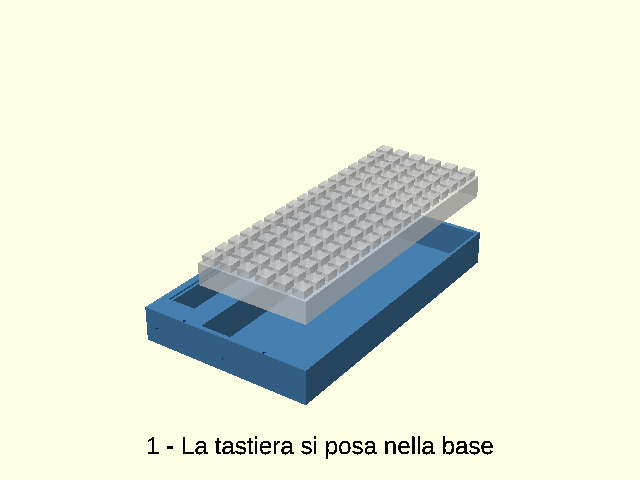
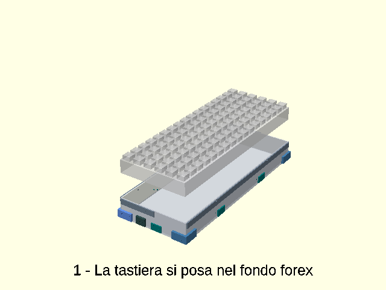
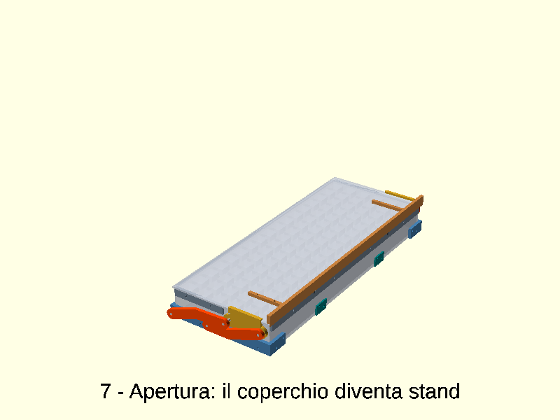

# Custodia per tastiera meccanica con coperchio-stand per tablet (versione compatta)

File sorgente: [`custodia_tastiera_stand.scad`](custodia_tastiera_stand.scad)
OpenSCAD standard, nessuna libreria esterna. Commenti nel codice in italiano.

> Questo file contiene **solo la variante compatta** (senza vano cavi, piastra
> posteriore e portellino), interamente stampata. La versione completa
> precedente è conservata, come riferimento storico, in
> [`custodia_tastiera_stand-rev0.scad`](custodia_tastiera_stand-rev0.scad)
> (**da non modificare**).
>
> Esiste anche una seconda realizzazione dello stesso progetto con le **facce
> piane in pannelli di forex** e inserti stampati di raccordo:
> [`custodia_tastiera_forex.scad`](custodia_tastiera_forex.scad), documentata
> nella [§8](#8-versione-forex-custodia_tastiera_forexscad) con le relative
> animazioni.

---

## 1. Di cosa si tratta

Una custodia (vasca) che ospita una tastiera meccanica. Base e coperchio sono
lunghi quanto il vano tastiera: **niente vano cavi, piastra posteriore,
portellino o telaio**. Il cavo esce dal retro attraverso una **fessura**
(`pass_w` × `pass_h`) ricavata nella parete posteriore, che fa anche da
**finecorsa** dell'apertura.

Il coperchio **non ruota su un perno fisso**: è vincolato da una
**cerniera a quadrilatero articolato** (four-bar linkage) presente su
**entrambi i lati**, quindi quando si apre **retrocede e si inclina
contemporaneamente**. Aperto a 55° il coperchio diventa uno **stand per
tablet**; il bordo inferiore si appoggia sullo spigolo superiore della parete
posteriore, che regge il peso del tablet.

```
CHIUSO                                   APERTO (55°)
┌──────────────────┐                  base ──┐
│  coperchio       │                        ┌┼────── coperchio inclinato
│ ═════════════════│                        ││  ▲      (tablet appoggiato)
│  tastiera        │                        ││ 55°
└──────────────────┘                        └┴── bielle a gomito ai lati
        └ fessura cavi
```

### Quadrilatero articolato (per lato)

| Braccio | Elemento |
|---|---|
| B1 – P1 | **biella1** (B1 = perno fisso nella parete della base) |
| B2 – P2 | **biella2** (B2 = perno fisso nella parete della base) |
| P1 – P2 | **coppia** = il coperchio con le orecchie incollate |

Livelli lungo Y, dall'interno verso l'esterno, separati dal gioco `g`:

```
parete base | orecchio | biella1 | biella2
```

I perni B1/B2 attraversano: parete + orecchio (zona libera) + biella;
i perni P1/P2 collegano orecchio e biella.

**Cerniera ricompattata.** Perché i perni fissi B1/B2 restino dentro le pareti
laterali della vasca, le orecchie sono spostate in avanti (`lp1_u = 8`,
`lp2_u = 50`), i perni B sono bassi (`zb1 = zb2 = 10`) e le bielle sono
**a gomito** (il corpo non convesso scivola oltre i perni dell'altra biella).
L'apertura scende a **55°**: con 70° l'invariante di branca del quadrilatero
porrebbe B2 fuori dalla vasca (`B2.x > fermata + 5.5 mm`).

### Componenti stampati (5 pezzi, 8 con la suddivisione)

1. **base** – vasca con vano tastiera aperto in alto e fessura cavi nella
   parete posteriore; fori passanti per i perni delle bielle
   (`foro_B_passante`), alloggi magneti opzionali.
2. **coperchio** – piastra con fermo e guide per il tablet, tasche per le
   orecchie. Si stampa a faccia posteriore sul letto.
3. **2 orecchie** – incollate nel coperchio (profilo = inviluppo di due cerchi
   sui perni P1/P2 + tenone) e **fissate con 2 viti/perni Ø3 passanti per
   ciascuna**: il foro attraversa piastra + tenone + corpo dell'orecchio
   (`usa_viti_orecchio`).
4. **2 biella1 + 2 biella2** – profilo a fessura con fori per i perni
   (a gomito con `bielle_gomito = true`, predefinita).

Non stampati: **4 perni da 3 mm** (B1, B2, P1, P2 per lato) — barre, filo
lisciato o filamento.

> **Suddivisione per letti piccoli** (`splitta = true`, predefinita): base
> e coperchio vengono generati come **due metà ciascuno** con giunzione a
> **incasto a pettine**. Vedere la [§6.1](#61-suddivisione-in-metà-con-incasto-a-pettine).

---

## 2. Cinematica e verifiche

La sintesi è a due posate ed è **interamente parametrica**:

- **Chiusa**: origine coperchio `Oc = [0, Ztop]`, angolo 0° (poggia sul bordo).
- **Aperta**: origine `Oo = [D_kb − wall_f/2, Ztop]`, angolo `ang_open` (55°);
  il bordo inferiore poggia sullo spigolo superiore della parete posteriore
  (finecorsa).
- Ogni perno coperchio `lp_i` ha due posazioni; il perno fisso `B_i` giace
  sull'**asse del segmento** tra le due, alla quota `zb_i`.
- Lunghezze: `L1 = |P1c−B1|`, `L2 = |P2c−B2|`, `d12 = |P2c−P1c|`.
- Le pose intermedie derivano ruotando la biella1 e risolvendo
  l'**intersezione di due cerchi**; il ramo corretto è scelto in modo analitico
  (quello che nella posa chiusa restituisce esattamente la posa chiusa).

### Verifiche a runtime

Ad ogni compilazione il file scrive in console (`echo`) i risultati su 21 pose
intermedie. Con i valori predefiniti:

```
SINTESI:  L1 = 71.170  L2 = 75.589  d12 = 42
PERNI FISSI:  B1 = [77.348, 10]   B2 = [123.876, 10]
VERIFICHE:  P2-biella1 = 9.04 (>=7.7) | B1-biella2 = 9.85 (>=7.7) |
            P1-biella2 = 0.15 | B1-coperchio = 28 | B2-coperchio = 28 |
            B2-biella1 = 15.85 (>=7.7)
```

- movimento continuo da 0 a 1, nessun cambio di ramo;
- le distanze perno-corpo biella sono verificate con `assert`
  (soglia = `link_w/2 + raggio foro`);
- i valori `P1-biella2` (e simili) sono controlli **2D** nel profilo
  (x, z), quindi conservativi: le bielle vivono su **livelli Y separati**
  (parete | orecchio | biella1 | biella2) e in 3D non entrano in contatto.

> **Dopo ogni modifica ai parametri della cerniera: ricompila e rileggi gli
> `echo`** (e riattiva l'animazione per controllare il moto).

---

## 3. Parametri principali (in testa al file)

| Gruppo | Parametri | Note |
|---|---|---|
| Tastiera | `kb_w, kb_d, kb_h, tol` | `tol` = gioco tra tastiera e pareti |
| Tablet | `tablet_w, tablet_h, tablet_t` | determinano fermo e guide |
| Spessori | `floor_t, wall_f, wall_s, top_gap, t_lid, lip_t, guide_t, guide_l` | |
| Cerniera | `pin_d, link_t, ear_t, g, link_w, ear_r, ang_open, lp1_u, lp2_u, piv_v, zb1, zb2` | la sintesi si ricalcola da sola |
| Cerniera a gomito | `bielle_gomito, gomito1_f, gomito1_e, gomito2_f, gomito2_e` | bielle a gomito (consigliate) |
| Cavi | `pass_w, pass_h` | fessura di uscita nella parete posteriore |
| Fori perni B | `foro_prof, foro_B_passante` | passanti o ciechi |
| Perni stampati | `stampa_perni, perno_stamp_d` | per la prova senza barre |
| Viti orecchie | `usa_viti_orecchio, vit_d, vit_gioco, vit_svaso, vit_svaso_d` | fori passanti viti/perni Ø3 tra coperchio e orecchie |
| Suddivisione stampa | `splitta, seam_base_y, seam_cop_y, n_denti, dent_d, inc_gioco` | incasto a pettine per stampare base e coperchio in due metà (vedi §6.1) |
| Magneti | `usa_magneti, mag_d, mag_h, mag_p1, mag_p2` | 4×2 mm, 2 per lato |
| Vista | `mostra, animazione, t_manuale, camera_auto` | vedi sotto |

Grandezze derivate: `D_kb, Ztop, Wi, Wt, Wl` e i livelli Y (`Yw0…Yl21`).
Base e coperchio sono entrambi lunghi `D_kb`. Alcuni `assert` bloccano la
compilazione con messaggio chiaro se una combinazione di parametri non è
coerente.

> **Stampa di prova in miniatura**: si può ottenere sovrascrivendo i parametri
> con `-D` o nel Customizer (tastiera ~50 × 30 × 10 mm, cerniera ricalcolata
> in scala: `piv_v = 4, lp1_u = 6, lp2_u = 28, zb1 = 4, zb2 = 6, ear_r = 3.5,
> link_w = 6, link_t = 2, ear_t = 2, g = 0.4, pin_d = 2, foro_prof = 2`).
> Vincolo: `ear_r` deve restare **strettamente minore** di `piv_v`. Verifica
> sempre gli `echo` a compilazione.

---

## 4. Come visualizzare

Cambia la variabile `mostra` e premi **F5** (preview) o **F6** (render):

| `mostra` | Contenuto |
|---|---|
| `"assieme"` | tutto montato nella posa aperta (con perni) |
| `"stampa"` | pezzi disposti piatti sul piano di stampa (metà se `splitta`) |
| `"base"` / `"coperchio"` | pezzo in assetto di stampa (le 2 metà se `splitta`) |
| `"base_a"` / `"base_b"` / `"coperchio_a"` / `"coperchio_b"` | singola metà, per esportarla come STL dedicato |
| `"incasto"` | metà di base e coperchio allontanate per ispezionare la giunzione |
| `"orecchio"` / `"biella1"` / `"biella2"` | le 2 copie in assetto di stampa |

Per le viste di layout (`stampa`, `incasto`, `base*`, `coperchio*`) la camera
si allarga automaticamente per inquadrare l'intero piano.

### Esportare gli STL da riga di comando

```sh
openscad -o base.stl        custodia_tastiera_stand.scad -D "mostra=\"base\""
openscad -o base_a.stl      custodia_tastiera_stand.scad -D "mostra=\"base_a\""
openscad -o base_b.stl      custodia_tastiera_stand.scad -D "mostra=\"base_b\""
openscad -o coperchio.stl   custodia_tastiera_stand.scad -D "mostra=\"coperchio\""
openscad -o coperchio_a.stl custodia_tastiera_stand.scad -D "mostra=\"coperchio_a\""
openscad -o coperchio_b.stl custodia_tastiera_stand.scad -D "mostra=\"coperchio_b\""
openscad -o orecchio.stl    custodia_tastiera_stand.scad -D "mostra=\"orecchio\""
openscad -o biella1.stl     custodia_tastiera_stand.scad -D "mostra=\"biella1\""
openscad -o biella2.stl     custodia_tastiera_stand.scad -D "mostra=\"biella2\""
openscad -o assieme.stl     custodia_tastiera_stand.scad -D "mostra=\"assieme\""
```

In alternativa: F6 → *File → Export → Export as STL*.

---

## 5. Come creare l'animazione

Il file implementa un'animazione a **8 fasi** con raccordi *smoothstep*,
attivata dalla variabile `animazione` (usa la variabile speciale `$t` di
OpenSCAD):

| Fase | Contenuto |
|---|---|
| 1 | la tastiera (fantasma grigia) si posa nella base |
| 2 | le orecchie scorrono di lato nelle tasche del coperchio (sollevato) |
| 3 | il coperchio scende sulla base |
| 4 | inserimento biella1 di lato |
| 5 | inserimento biella2 di lato |
| 6 | inserimento dei perni dall'esterno |
| 7 | apertura: il coperchio diventa stand (0 → 1) |
| 8 | il tablet (fantasma blu trasparente) scorre fino al fermo |

In ogni fase una **didascalia 3D** è mostrata in basso nella vista (orientata
verso la camera) e stampata in console con `echo`.

### 5.1 Modalità

```scad
animazione = "tutto";      // tutte le 8 fasi in sequenza
animazione = "assembla";   // solo le fasi 1-6 (montaggio), resta chiuso
animazione = "apri";       // parti da tutto montato: fasi 7-8
animazione = "nessuna";    // statico (usa `mostra`)
```

Per congelare un istante preciso (utile per screenshot) senza far girare il
tempo:

```scad
t_manuale = 0.55;   // istante forzato 0..1; ha priorità su $t (0 = disattivo)
```

### 5.2 Avvio nell'interfaccia grafica (GUI)

1. Apri il file, imposta `animazione = "tutto"` e salva.
2. Menu **View → Animate**: compare la barra in basso con i campi
   *FPS*, *Steps* e il pulsante Play.
3. Imposta per esempio:
   - **FPS = 12** (frame al secondo);
   - **Steps = 96** → per `"tutto"`: 8 fasi × 12 step = ciclo completo fluido
     (72 per `"assembla"`, 24 per `"apri"`).
4. Premi **Play ▶**. Con **F5** (preview) vedi colori e trasparenze dei
   fantasmi; la modalità animate ha senso solo in preview.
5. La camera è già impostata dal file
   (`$vpr=[62,0,215]`, `$vpt=[100,0,70]`, `$vpd=1250`). Per orbitare liberamente
   col mouse durante l'animazione metti `camera_auto = false;`.

Puoi anche scrivere a mano un valore di `$t` nel campo a sinistra della barra
Animate per esaminare un singolo istante.

### 5.3 Creare un video (riga di comando + ffmpeg)

OpenSCAD CLI genera una PNG per ogni step di `$t` con `--animate`:

```sh
mkdir frames
openscad -o frames/frame.png --animate 12 --imgsize 1280,720 \
         --camera 100,0,70,1250,62,0,215 \
         custodia_tastiera_stand.scad
```

- `--animate 12` = 12 step per unità di `$t` (96 frame per il ciclo "tutto":
  OpenSCAD genera `frame0001.png`, `frame0002.png`, …);
- `--camera x,y,z,dist,rx,ry,rz` riproduce la camera del file;
- assicurati che nel file `animazione = "tutto"` e `t_manuale = 0`.

Assembla il video con **ffmpeg**:

```sh
ffmpeg -framerate 12 -i frames/frame%04d.png -pix_fmt yuv420p animazione.mp4
```

Per un video più fluido aumenta `--animate` (es. 24 → 192 frame) e
`-framerate` di conseguenza.

### 5.4 GIF già pronte nel progetto

Nel progetto sono incluse tre GIF (cartella [`img/`](img/)) generate con la
CLI di OpenSCAD a partire dalla **versione completa precedente** (base più
lunga, con vano cavi): le fasi di montaggio e apertura restano
rappresentative, ma per la versione compatta conviene **rigenerarle** con la
procedura qui sotto. Per la versione forex ci sono GIF dedicate nella
[§8.4](#84-animazioni-della-versione-forex).

| File | Contenuto | Frame |
|---|---|---|
| `img/animazione_apertura.gif` | fasi 7–8 (`animazione = "apri"`): apertura 0→1 e tablet al fermo | 48 @ 800×600 |
| `img/animazione_completa.gif` | tutte le 8 fasi (`animazione = "tutto"`): montaggio + apertura | 96 @ 640×480 |
| `img/animazione_assemblaggio.gif` | fasi 1–6 (`animazione = "assembla"`): solo montaggio, resta chiuso | 72 @ 640×480 |

**Funzionamento — apertura 0→1 e tablet che scorre fino al fermo**:


**Montaggio completo nelle otto fasi**:


**Solo montaggio** — le prime 6 fasi, si ferma a coperchio chiuso:



> Le GIF si vedono in anteprima su GitHub/GitLab e in qualunque visualizzatore
> Markdown che supporti le immagini animate; si vedono anche in VS Code
> (Markdown Preview).

Procedura per rigenerarle (output in `img/`):

1. si crea una **copia temporanea** del `.scad` con `animazione` impostato
   (`"apri"` o `"tutto"`; così si evitano problemi di quoting di `-D`);
2. si renderizzano i frame:
   ```sh
   openscad -o apri.png --imgsize=800,600 --animate 48 anim_apri.scad
   ```
   → produce `apri00000.png … apri00047.png`;
3. si assembla la GIF con PIL (loop infinito, ~17 fps, pausa finale sullo
   stato concluso) e la si salva in `img/`:
   ```python
   from PIL import Image
   files = sorted(glob.glob("apri0*.png"))
   imgs  = [Image.open(f).convert("RGB") for f in files]
   imgs[0].save("img/animazione_apertura.gif", save_all=True,
                append_images=imgs[1:], duration=[60]*len(imgs), loop=0,
                optimize=True)
   ```

Nota: la didascalia 3D è ancorata al bordo inferiore della vista tramite il
vettore "su dello schermo" della camera gimbal (`R(vpr)·[0,1,0]`); se cambi
`$vpd` o la camera, riaggiusta l'offset in `didascalia()`.

### 5.5 Buone pratiche

- L'animazione è la **verifica visiva della cinematica**: dopo ogni modifica ai
  parametri della cerniera riattivala e guarda le fasi 7 (nessun salto, nessun
  contatto) e 8 (il tablet si ferma sul fermo).
- Se qualcosa "trema" o salta in preview, alza la finestra di OpenSCAD: la
  preview ricampiona la scena a ogni frame.
- Le `assert` del file proteggono comunque la compilazione: se un parametro
  rende il meccanismo incoerente, OpenSCAD si ferma con un messaggio.

---

## 6. Stampa e montaggio

- **Letto di stampa**: con `splitta = true` (predefinita) base e coperchio si
  dividono in **metà ≈ 130 × 166 mm** (base) e **130 × 170 mm** (coperchio)
  con i valori predefiniti: entrano su un piatto **200 × 200**.
- **Materiale**: PETG o ABS consigliati per la base (rigidità + resistenza
  termica al sole); il coperchio-stand è meglio in PETG/ABS pieno.
- **Parametri suggeriti**: 0.2 mm di strato, 3 perimetrature, riempimento
  ≥ 25 % (gyroid o cubic) per base e coperchio; orecchie e bielle al 100 % o
  con 6 perimetrature (i perni lavorano a compressione sui fori).
- **Supporti**: non necessari in nessun pezzo (tutti i fori orizzontali sono
  passanti; anche le facce di giunzione sono verticali).
- **Montaggio**:
  1. se `splitta`: **incasta e incolla le metà** (vedi §6.1) e lascia
     polymerizzare prima di continuare,
  2. incolla le orecchie nelle tasche del coperchio (il tenone entra nella
     tasca; cianoacrilato o epossidica),
  3. fissa ogni orecchio con **2 viti o perni Ø3 passanti** (`usa_viti_orecchio`):
     il foro esce sotto l'orecchio, quindi si può usare un perno incollato o
     una vite con dado (o autofilante in pressione nel foro Ø3.2),
  4. appoggia il coperchio chiuso sulla base: i fori di B1/B2 si allineano,
  5. inserisci le bielle di lato nelle rispettive fasce Y,
  6. spingi i **perni da 3 mm** dall'esterno (B1/B2 attraversano parete +
     orecchio + biella; P1/P2 orecchio + biella).

### 6.1 Suddivisione in metà con incasto a pettine

Con `splitta = true` (predefinita) **base** e **coperchio** vengono generati
come **due metà ciascuno**. La base si divide lungo il piano Y = `seam_base_y`,
il coperchio lungo `seam_cop_y` (predefiniti: al centro, y = 0). La giunzione
è un **incasto a pettine**: la metà A (y minore) porta i denti (lunghezza
`D_kb/(2·n_denti)`, profondità `dent_d`); la metà B ha le **predelle**
maggiorate del gioco `inc_gioco`. Le metà si incastrano **scorrendo lungo +Y**:

- il pettine **allinea** le parti con precisione (niente riferimenti a
  occhio),
- si oppone a **strappo** (y), **taglio** (x) e flessione del giunto,
- la colla (epossidica consigliata: i tagli attraversano fondo e pareti)
  completa il fissaggio; le metà incollate riproducono il pezzo intero,
  quindi assieme e animazione non cambiano.

**Controlli e uso:**

- vista `mostra = "incasto"`: le metà allontanate per ispezionare denti e
  predelle; è la verifica da fare **dopo ogni cambio di `n_denti`, `dent_d`,
  `inc_gioco` o delle quote `seam_*`**;
- esportazione per pezzo: `mostra = "base_a" / "base_b" / "coperchio_a" /
  "coperchio_b"` → un STL per metà, pronto per lo slicer;
- il taglio attraversa anche la fessura cavi della parete posteriore: le metà
  si riallineano da sole grazie al pettine;
- le zone critiche (tasche orecchie, fori viti, fori perni B) sono lontane
  dalla giunzione di default; se sposti `seam_*_y`, verifica con la vista
  `incasto` che non intersechi quelle zone;
- `splitta = false` riproduce il comportamento precedente (pezzi interi).

**Stampa delle metà**: stesso assetto dei pezzi interi (base com'è, coperchio
a faccia posteriore sul letto), facce di giunzione verticali → nessun
supporto. Con `inc_gioco` troppo stretto le metà non entrano: allargalo a
0.3–0.4 mm o leggi la prima impressione con la vista `incasto`.

---

## 7. Struttura del file (per orientarsi)

```
PARAMETRI ................ tastiera, tablet, spessori, cerniera (+ gomito),
                          cavi, magneti, viti orecchie, suddivisione,
                          vista/camera
GRANDEZZE DERIVATE ....... D_kb, Ztop, Wi, Wt, Wl, livelli Y, assert
CINEMATICA 2D (x, z) ..... rot2, ang_v, bialetta (sintesi), intersez_cerchi,
                          segno_ramo, posa(t), loc_cop + echo verifiche
MODULI ................... estrusa_y, base, coperchio_solido, in_coperchio,
                          profilo_orecchio (+ zona_libera_2d), biella e
                          biella_gomito, perno_sxy/perni_in_posa, fantasmi,
                          meta_incastro_A/B + meta_base/coperchio_A/B
MODALITA' DI VISTA ....... assieme, piano_stampa, stampa singoli pezzi e
                          meta' (base_a..coperchio_b), vista_incastro
ANIMAZIONE ............... sstep, fase(i), didascalie, didascalia 3D,
                          scena_animata
INVOCO ................... scelta per `mostra` / `animazione`
```

---

## 8. Versione forex (`custodia_tastiera_forex.scad`)

Seconda realizzazione dello stesso progetto: tutte le **facce piane sono
pannelli di forex** (PVC espanso) spessi 2 mm, tagliati a misura, mentre lo
stampato si riduce a **inserti di raccordo**. La cerniera (quadrilatero
articolato, apertura 55°, bielle a gomito), la cinematica e le orecchie sono
identiche alla versione compatta: cambia solo il modo in cui si costruiscono
base e coperchio.

### 8.1 Pannelli (da ritagliare)

Tutte le facce piane sono forex da `fx_t = 2` mm. Con i valori predefiniti
(tastiera 320 × 124 × 32):

| Pannello | Misure (mm) | Note |
|---|---|---|
| Fondo | 329,2 × 128 | aggetto di 2 mm per lato: il bordo entra nella scanalatura del nervo laterale |
| Pareti laterali (2) | 128 × 33 | fori del nervo laterale e delle cappe laterali; il bordo superiore entra nello scasso della cappa |
| Parete frontale | 321,2 × 33 | fori delle alette del nervo, staffe e cappe; bordo superiore nello scasso della cappa |
| Parete posteriore | 321,2 × 33 | come la frontale + **fessura cavi 20 × 10** da ritagliare al fondo |
| Coperchio | 131 × 332,4 | sporge di 3 mm in avanti (il bordo entra nello scasso del fermo) e per lato (negli scassi delle orecchie); fori guide + segni di posizione |

Le misure si ricalcolano dai parametri: a ogni compilazione gli `echo`
riportano le dimensioni aggiornate. Con i valori predefiniti la cerniera
sintetizza `B1 = [76.53, 10]`, `B2 = [122.93, 10]` (L1 = 70.15, L2 = 74.45,
d12 = 42) e le verifiche a runtime superano le soglie.

**Vista `mostra = "pannelli"`**: i 5 sagomi già forati, affiancati e pronti da
esportare (STL o SVG/DXF via `projection()`), stampabili e utilizzabili come
**maschere di trapanatura** sul forex. I fori a bordo (orecchie e fermo) sono
solo **segni di posizione**: nel reale il foro si fa nel bordo del pannello,
in orizzontale.

### 8.2 Inserti stampati (tutti verso l'esterno)

Dentro la vasca non sporge nulla: la tastiera occupa tutto il vano.

| Pezzo | Copie | Funzione |
|---|---|---|
| Nervo laterale | 2 | traversa unica per parete laterale, dallo spigolo posteriore a quello frontale: **fori passanti perni B1 e B2** (aggancio bielle) + alette sugli spigoli delle pareti corte |
| Staffa a T frontale/posteriore | 4 | rinforzo bordo pareti corte |
| Cappa laterale | 2 | bordo superiore parete laterale (il coperchio vi appoggia) |
| Cappa frontale/posteriore | 4 | bordo superiore pareti corte + **alloggio magnete** |
| Orecchio | 2 | cerniera: perni P1/P2 + fissaggio al bordo del pannello |
| Fermo tablet (segmenti) | 2 | bordo inferiore del coperchio, ferma il tablet |
| Guida tablet | 2 | guide laterali sulla faccia del pannello |
| Biella1 / biella2 | 2 + 2 | cerniera a gomito |
| Perni cerniera | 8 | barre Ø3: **P1 = 8,6 · B1 = 9,2 · P2 = 13,2 · B2 = 13,8 mm** |

Tutti gli inserti si **posizionano** sui pannelli con perni Ø2 e si fissano
poi con colla (epossidica o cianoacrilica). Dove il pezzo incontra un **bordo**
del pannello, il fissaggio è a **scasso**: il forex entra dentro il pezzo
stampato e resta ingranato, non solo incollato:

- **cappe** = sellhe di incastro sul bordo superiore delle pareti (i pannelli
  sono accorciati di `cap_t` e il ponte della sella riporta il sostegno del
  coperchio a filo, a Ztop);
- **orecchie e fermo** = scasso (tasca) in cui scorre il bordo del pannello
  coperchio, con labbro di chiusura;
- **nervo e staffe** = labbro a filo fondo che cattura il bordo laterale del
  fondo, impedendogli di scivolare verso l'esterno;
- le **guide** del tablet sono a metà faccia (nessun bordo disponibile):
  restano a perni Ø2 + colla.

### 8.3 Giunti a perno (`f_cieco`)

Ogni inserto ha 2 maschi/fori di posizione; nel pannello il foro è passante
Ø `f_pin + f_pin_g` = Ø2,2 (posizione nel sagomo).

- **`f_cieco = true`** — maschi Ø `f_pin` × `fx_t` (2 × 2 mm) stampati
  sull'inserto, press-fit nel foro del pannello: giunto permanente (colla).
- **`f_cieco = false`** (predefinito) — foro passante anche nell'inserto:
  si usano **barre Ø2** tagliate a misura (8 mm per angoli, boss, staffe,
  orecchio, fermo e guide; 3,5 mm per le cappe). Il giunto resta
  **smontabile** tirando la barra.

I perni della cerniera (B1, B2, P1, P2) restano **barre da 3 mm**, con foro
passante nel boss/angolare: il perno entra da fuori e poggia sulla faccia
esterna della parete.

### 8.4 Animazioni della versione forex

Due GIF generate con la CLI di OpenSCAD (2026.11.14) dalla versione forex:

**Assemblaggio** — le fasi 1–6: tastiera nel fondo forex, orecchie sui bordi
del pannello, coperchio, bielle a gomito, perni da 3 mm
(`animazione = "assembla"`, 72 frame @ 640×480):



**Funzionamento** — apertura 0→55° (il coperchio retrocede e si appoggia
sullo spigolo della parete posteriore) e tablet che scorre fino al fermo
(`animazione = "apri"`, 48 frame @ 800×600):



Procedura per rigenerarle (uguale alla §5.4, con le dimensioni in tabella):

```sh
openscad -o frame.png --imgsize 640,480 --animate 72 \
         custodia_tastiera_forex.scad -D 'animazione="assembla"'
openscad -o frame.png --imgsize 800,600 --animate 48 \
         custodia_tastiera_forex.scad -D 'animazione="apri"'
```

Le fasi 2/3 mostrano il **pannello coperchio come fantasma semitrasparente**
(come il fondo e le pareti): i pannelli di forex non si stampano, quindi
nella scena sono rappresentati trasparenti con il colore del PVC.

### 8.5 Stampa e montaggio (versione forex)

- **Letto di stampa**: nessun pezzo supera ~165 mm (cappe e fermo sono
  segmentati: `cappe_n = 2`, `fermo_n = 2`).
- **Materiale**: PETG per gli inserti strutturali (nervi laterali, cappe,
  orecchie, fermo); le staffe possono essere PLA. Riempimento ≥ 25 %,
  3 perimetrature; orecchie e bielle al 100 % o 6 perimetrature.
- **Supporti**: non necessari.
- **Sequenza di montaggio**:
  1. stampa i sagomi (`mostra = "pannelli"`) e ritaglia i 5 pannelli,
     forando dove marcato (foro Ø2,2; per orecchie/fermo fora il bordo,
     in orizzontale; ritaglia la fessura cavi nel posteriore),
  2. incolla le pareti sul fondo (linea di colla continua sui bordi),
  3. applica gli inserti con i perni Ø2 di posizione + colla: nervi
     laterali, staffe, cappe (incolla i magneti Ø4×2 a filo nelle cappe e usa
     rondelle/dischi ferrosi sul coperchio, il forex non è ferromagnetico),
  4. i perni Ø3 delle cerniere si spingono da fuori nei fori del nervo,
  5. coperchio: incolla fermo e guide sul pannello (perni Ø2 + colla),
     poi le orecchie contro i bordi laterali,
  6. bielle e perni Ø3 come nella versione stampata (§6).
- **Tablet pesanti**: la parete posteriore da 2 mm sostiene il finecorsa:
  per carichi elevati incolla un secondo strato di forex dietro la parete
  (sandwich) o rinforza con le cappe più spesse (`cap_t`).

### 8.6 Parametri principali (versione forex)

| Gruppo | Parametri | Note |
|---|---|---|
| Forex | `fx_t, top_gap` | spessore pannelli, gioco sopra i keycap |
| Perni di posizione | `f_pin, f_pin_g, f_cieco, f_bar_prof` | Ø2, gioco, maschi/barre |
| Cerniera | `pin_d, link_t, ear_t, g, link_w, ear_r, ang_open, lp1_u, lp2_u, piv_v, zb1, zb2` | identica alla versione compatta |
| Bielle a gomito | `bielle_gomito, gomito1_f, gomito1_e, gomito2_f, gomito2_e` | |
| Inserti base | `leg_t, leg_l, leg_h, t_len, t_h, ins_t_fr, nervo_tab_fr` | nervo laterale, staffe |
| Cappe | `cap_t, cap_h, cappe_n` | bordi superiori, segmentazione |
| Cavi | `pass_w, pass_h` | fessura nella parete posteriore |
| Coperchio | `fermo_t, fermo_n, fermo_tab, guide_t, guide_l, guide_u0, guide_tab` | fermo e guide |
| Magneti | `usa_magneti, mag_d, mag_h, mag_p1, mag_p2` | alloggi nelle cappe |

Le `assert` bloccano la compilazione con messaggi chiari in caso di
sovrapposizioni tra inserti o perni fuori sede.

---

*Licenza: uso libero; cita l'autore se ridistribuisci il file.*
