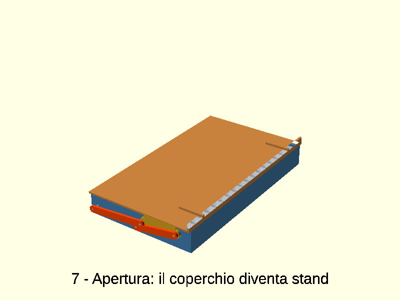

# Custodia per tastiera meccanica con coperchio-stand per tablet

File sorgente: [`custodia_tastiera_stand.scad`](custodia_tastiera_stand.scad)
OpenSCAD standard, nessuna libreria esterna. Commenti nel codice in italiano.

---

## 1. Di cosa si tratta

Una custodia (vasca) che ospita una tastiera meccanica. Il coperchio **non ruota
su un perno fisso**: è vincolato da una **cerniera a quadrilatero articolato**
(four-bar linkage) presente su **entrambi i lati**, quindi quando si apre
**retrocede e si inclina contemporaneamente**. Aperto a 70° il coperchio diventa
uno **stand per tablet** (stile mini-iPad con tastiera); il bordo inferiore del
coperchio si appoggia sulla piastra del vano posteriore, che fa **finecorsa**
contro il peso del tablet.

```
CHIUSO                                APERTO (70°)
┌──────────────────────┐              base ──┐
│  coperchio (piastra) │                    ┌┼────── coperchio inclinato
│ ═════════════════════│                    ││  ▲      (tablet appoggiato)
│ tastiera │ vano cavi │                    ││ 70°
└──────────────────────┘                    └┴── bielle articolate ai lati
```

### Quadrilatero articolato (per lato)

| Braccio | Elemento |
|---|---|
| B1 – P1 | **biella1** (B1 = perno fisso nella parete della base) |
| B2 – P2 | **biella2** (B2 = perno fisso nella parete della base) |
| P1 – P2 | **coppia** = il coperchio con le orecchie incollate |

Livelli lungo Y, dall'interno verso l'esterno, separati dal gioco `g`:

```
parete base | orecchio | biella1 | biella2
```

I perni B1/B2 attraversano: parete + orecchio (zona libera) + biella;
i perni P1/P2 collegano orecchio e biella.

### Componenti stampati (7 pezzi, fino a 10 con la suddivisione)

1. **base** – vasca con vano tastiera frontale, vano posteriore per cavi e
   accessori (**apribile con portellino a incasso**), passaggio cavi nel
   tramezzo, fori ciechi per i perni, alloggi magneti opzionali.
2. **coperchio** – piastra con fermo e guide per il tablet, tasche per le
   orecchie. Si stampa a faccia posteriore sul letto.
3. **2 orecchie** – incollate nel coperchio (profilo = inviluppo di due cerchi
   sui perni P1/P2 + tenone) e **fissate con 2 viti/perni Ø3 passanti per
   ciascuna**: il foro attraversa piastra + tenone + corpo dell'orecchio
   (`usa_viti_orecchio`).
4. **2 biella1 + 2 biella2** – profilo a fessura con fori per i perni.

Non stampati: **4 perni da 3 mm** (B1, B2, P1, P2 per lato) — barre, filo
lisciato o filamento.

> **Suddivisione per letti piccoli** (`splitta = true`, predefinita): base,
> coperchio e portellino — i tre pezzi più lunghi — vengono generati come
> **due metà ciascuno** con giunzione a **incasto a pettine**: in tutto
> 12 pezzi stampati. Vedere la [§6.1](#61-suddivisione-in-metà-con-incasto-a-pettine).

---

## 2. Cinematica e verifiche

La sintesi è a due posate ed è **interamente parametrica**:

- **Chiusa**: origine coperchio `Oc = [0, Ztop]`, angolo 0° (poggia sul bordo).
- **Aperta**: origine `Oo = [D_kb + open_dx, Ztop]`, angolo `ang_open` (70°);
  il bordo inferiore poggia sulla piastra posteriore (finecorsa).
- Ogni perno coperchio `lp_i` ha due posizioni; il perno fisso `B_i` giace
  sull'**asse del segmento** tra le due, alla quota `zb_i`.
- Lunghezze: `L1 = |P1c−B1|`, `L2 = |P2c−B2|`, `d12 = |P2c−P1c|`.
- Le pose intermedie derivano ruotando la biella1 e risolvendo
  l'**intersezione di due cerchi**; il ramo corretto è scelto in modo analitico
  (quello che nella posa chiusa restituisce esattamente la posa chiusa).

### Verifiche eseguite (Python/numpy prima della stesura) e ripetute a runtime

Ad ogni compilazione il file scrive in console (`echo`) i risultati su 21 pose
intermedie. Con i valori predefiniti:

```
SINTESI:  L1 = 73.050  L2 = 95.861  d12 = 60
PERNI FISSI:  B1 = [97.058, 14]   B2 = [180.526, 18]
VERIFICHE:  P2-biella1 = 9.9 (>=8) | B1-biella2 = 11.0 (>=8) |
            P1-biella2 = 23.0 (>=20) | B1-coperchio = 24 (>=15) |
            B2-coperchio = 20 (>=15) | B2-biella1 = 46.4
```

- movimento continuo da 0 a 1, nessun cambio di ramo (max passo 2.4·10⁻⁵ mm);
- il sottocoperchio non penetra mai i keycap (gioco ≥ 3 mm) né la piastra
  posteriore (contatto esattamente 0, mai negativo);
- il baricentro, vicino alla posa aperta, spinge **verso il finecorsa**
  (dz/dt < 0): la gravità fa appoggiare il coperchio, non lo apre oltre.

> **Dopo ogni modifica ai parametri della cerniera: ricompila e rileggi gli
> `echo`** (e riattiva l'animazione per controllare il moto).

---

## 3. Parametri principali (in testa al file)

| Gruppo | Parametri | Note |
|---|---|---|
| Tastiera | `kb_w, kb_d, kb_h, tol` | `tol` = gioco tra tastiera e pareti |
| Tablet | `tablet_w, tablet_h, tablet_t` | determinano fermo e guide |
| Spessori | `floor_t, wall_f, wall_s, rear_top, top_gap, t_lid, lip_t, guide_t, guide_l` | |
| Cerniera | `pin_d, link_t, ear_t, g, link_w, ear_r, ang_open, open_dx, lp1_u, lp2_u, piv_v, zb1, zb2` | la sintesi si ricalcola da sola |
| Vano posteriore | `vano_d` | profondità interna: se cresce allunga la base |
| Portellino | `porta_aperta, porta_l, porta_cornice, porta_w, porta_t, porta_lip, porta_gioco, porta_foro_l, porta_foro_d, porta_foro_dx, porta_x` | a incasso, a filo, con foro pollice |
| Fissaggio orecchie | `usa_viti_orecchio, vit_d, vit_gioco, vit_svaso, vit_svaso_d` | fori passanti viti/perni Ø3 tra coperchio e orecchie |
| Suddivisione stampa | `splitta, seam_base_y, seam_cop_y, n_denti, dent_d, inc_gioco, splitta_porta, seam_porta_y, n_denti_porta, dent_d_porta` | incasto a pettine per stampare base, coperchio e portellino in due metà (vedi §6.1) |
| Magneti | `usa_magneti, mag_d, mag_h, mag_p1, mag_p2` | 4×2 mm, 2 per lato |
| Vista | `mostra, animazione, t_manuale, camera_auto` | vedi sotto |

Granidezze derivate: `D_kb, Ztop, Lu, Wi, Wt, Wl` e i livelli Y
(`Yw0…Yl21`). Alcuni `assert` bloccano la compilazione con messaggio chiaro se
una combinazione di parametri non è coerente (es. `porta_t >= rear_top`).

### 3.1 Modello di prova in miniatura (preset `Test-mini`)

Nel Customizer (o nel file `custodia_tastiera_stand.json`) sono inclusi due
preset per una **stampa di prova** della cerniera con una tastiera
**50 × 30 × 10 mm**:

| Preset | `mostra` | Uso |
|---|---|---|
| `Test-mini` | `assieme` | controllo visivo dell'assieme aperto |
| `Test-mini-stampa` | `stampa` | **tutte le parti su un piatto ≈ 348 × 62 mm** |

Poiché `kb_h=10` porta `Ztop` da 38 a 14 mm, i parametri della cerniera sono
**ricalcolati in scala** nel preset (non bastano quelli del progetto reale):
`piv_v=4, lp1_u=6, lp2_u=28, zb1=4, zb2=6, open_dx=3, ear_r=3.5, link_w=6,
link_t=2, ear_t=2, g=0.4, pin_d=2, foro_prof=2`; magneti e fori viti
disattivati (a questa scala non c'entrano con il test di apertura).

- **Vincolo duro**: `ear_r` deve essere **strettamente minore** di `piv_v`
  (il gap fra corpo orecchio e piastra è `piv_v − ear_r`; nel preset = 0,5 mm).
  Alzarlo a 4 con `piv_v=4` fa scattare l'assert di protezione.
- **Perni**: lunghezze `P1 = 4.4`, `B1 = 6.8`, `P2 = 6.8`, `B2 = 9.2` mm
  (2 copie ciascuno). Fori Ø2,4 (bielle/orecchie) e Ø2,1 ciechi nelle pareti:
  con barra da 2 mm il gioco è minimo; con filamento 1,75 c'è più gioco
  (accettabile per il test, oppure perni stampati a Ø1,9).
- In cartella ci sono anche **due copie autonome già configurate**
  (`test_mini_stampa.scad` e `test_mini.scad`) che non dipendono dal
  Customizer né dal JSON: se il Customizer dovesse applicare valori mescolati,
  usa direttamente quelle.
- **Orecchie**: una goccia di colla nelle tasche del coperchio.
- **Verifica**: gli `echo` a compilazione riportano la sintesi mini
  (`L1 = 21.5, L2 = 35.3, B1 = [26.7, 4], B2 = [63.1, 6]`) e le distanze
  minime; animazione di riferimento: `img/test_mini_apertura.gif`.
- Dopo la stampa: montaggio come al §6 e apertura a mano 0→70°: deve scorrere
  senza punti duri e il bordo inferiore deve appoggiarsi sulla piastra
  posteriore (finecorsa).

---

## 4. Come visualizzare

Cambia la variabile `mostra` e premi **F5** (preview) o **F6** (render):

| `mostra` | Contenuto |
|---|---|
| `"assieme"` | tutto montato nella posa aperta (con perni e portellino) |
| `"stampa"` | pezzi disposti piatti sul piano di stampa (metà se `splitta`) |
| `"base"` / `"coperchio"` | pezzo in assetto di stampa (le 2 metà se `splitta`) |
| `"base_a"` / `"base_b"` / `"coperchio_a"` / `"coperchio_b"` / `"porta_a"` / `"porta_b"` | singola metà, per esportarla come STL dedicato |
| `"incasto"` | metà di base e coperchio allontanate per ispezionare la giunzione |
| `"orecchio"` / `"biella1"` / `"biella2"` / `"portellino"` | le 2 copie in assetto di stampa |

Per le viste di layout (`stampa`, `incasto`, `base*`, `coperchio*`) la camera si
allarga automaticamente per inquadrare l'intero piano.

### Esportare gli STL da riga di comando

```bat
openscad -o base.stl        custodia_tastiera_stand.scad -D "mostra=\"base\""
openscad -o base_a.stl      custodia_tastiera_stand.scad -D "mostra=\"base_a\""
openscad -o base_b.stl      custodia_tastiera_stand.scad -D "mostra=\"base_b\""
openscad -o coperchio.stl   custodia_tastiera_stand.scad -D "mostra=\"coperchio\""
openscad -o coperchio_a.stl custodia_tastiera_stand.scad -D "mostra=\"coperchio_a\""
openscad -o coperchio_b.stl custodia_tastiera_stand.scad -D "mostra=\"coperchio_b\""
openscad -o orecchio.stl    custodia_tastiera_stand.scad -D "mostra=\"orecchio\""
openscad -o biella1.stl     custodia_tastiera_stand.scad -D "mostra=\"biella1\""
openscad -o biella2.stl     custodia_tastiera_stand.scad -D "mostra=\"biella2\""
openscad -o portellino.stl  custodia_tastiera_stand.scad -D "mostra=\"portellino\""
openscad -o porta_a.stl     custodia_tastiera_stand.scad -D "mostra=\"porta_a\""
openscad -o porta_b.stl     custodia_tastiera_stand.scad -D "mostra=\"porta_b\""
openscad -o assieme.stl     custodia_tastiera_stand.scad -D "mostra=\"assieme\""
```

In alternativa: F6 → *File → Export → Export as STL*.

---

## 5. Come creare l'animazione

Il file implementa un'animazione a **8 fasi** con raccordi *smoothstep*,
attivata dalla variabile `animazione` (usa la variabile speciale `$t` di
OpenSCAD):

| Fase | Contenuto |
|---|---|
| 1 | la tastiera (fantasma grigia) si posa nella base |
| 2 | le orecchie scorrono di lato nelle tasche del coperchio (sollevato) |
| 3 | il coperchio scende sulla base |
| 4 | inserimento biella1 di lato |
| 5 | inserimento biella2 di lato |
| 6 | inserimento dei perni dall'esterno |
| 7 | apertura: il coperchio diventa stand (0 → 1) |
| 8 | il tablet (fantasma blu trasparente) scorre fino al fermo |

In ogni fase una **didascalia 3D** è mostrata in basso nella vista (orientata
verso la camera) e stampata in console con `echo`.

### 5.1 Modalità

```scad
animazione = "tutto";      // tutte le 8 fasi in sequenza
animazione = "assembla";   // solo le fasi 1-6 (montaggio), resta chiuso
animazione = "apri";       // parti da tutto montato: fasi 7-8
animazione = "nessuna";    // statico (usa `mostra`)
```

Per congelare un istante preciso (utile per screenshot) senza far girare il
tempo:

```scad
t_manuale = 0.55;   // istante forzato 0..1; ha priorità su $t (0 = disattivo)
```

### 5.2 Avvio nell'interfaccia grafica (GUI)

1. Apri il file, imposta `animazione = "tutto"` e salva.
2. Menu **View → Animate**: compare la barra in basso con i campi
   *FPS*, *Steps* e il pulsante Play.
3. Imposta per esempio:
   - **FPS = 12** (frame al secondo);
   - **Steps = 96** → per `"tutto"`: 8 fasi × 12 step = ciclo completo fluido
     (72 per `"assembla"`, 24 per `"apri"`).
4. Premi **Play ▶**. Con **F5** (preview) vedi colori e trasparenze dei
   fantasmi; la modalita animate ha senso solo in preview.
5. La camera è già impostata dal file
   (`$vpr=[62,0,215]`, `$vpt=[100,0,70]`, `$vpd=1250`). Per orbitare liberamente
   col mouse durante l'animazione metti `camera_auto = false;`.

Puoi anche scrivere a mano un valore di `$t` nel campo a sinistra della barra
Animate per esaminare un singolo istante.

### 5.3 Creare un video (riga di comando + ffmpeg)

OpenSCAD CLI genera una PNG per ogni step di `$t` con `--animate`:

```bat
mkdir frames
openscad -o frames/frame.png --animate 12 --imgsize 1280,720 ^
         --camera 100,0,70,1250,62,0,215 ^
         custodia_tastiera_stand.scad
```

- `--animate 12` = 12 step per unità di `$t` (96 frame per il ciclo "tutto":
  OpenSCAD genera `frame0001.png`, `frame0002.png`, …);
- `--camera x,y,z,dist,rx,ry,rz` riproduce la camera del file;
- assicurati che nel file `animazione = "tutto"` e `t_manuale = 0`.

Assembla il video con **ffmpeg**:

```bat
ffmpeg -framerate 12 -i frames/frame%04d.png -pix_fmt yuv420p animazione.mp4
```

Per un video più fluido aumenta `--animate` (es. 24 → 192 frame) e
`-framerate` di conseguenza.

### 5.4 GIF già pronte nel progetto

Nel progetto sono incluse due GIF (cartella [`img/`](img/)) generate con la CLI
di OpenSCAD (2026.09.07,
`C:\Users\debora.presti\Software\OpenSCAD\openscad.exe`, versione 2026.11-RC0).

**Funzionamento — apertura 0→1 e tablet che scorre fino al fermo**
(fasi 7–8, `animazione = "apri"`, 48 frame @ 800×600):



**Montaggio completo nelle otto fasi** — tastiera, orecchie, coperchio,
bielle, perni, apertura, tablet
(`animazione = "tutto"`, 96 frame @ 640×480):


**Solo montaggio** — le prime 6 fasi, si ferma a coperchio chiuso
(`animazione = "assembla"`, 72 frame @ 640×480):


| File | Contenuto | Frame |
|---|---|---|
| `img/animazione_apertura.gif` | fasi 7–8 (`animazione = "apri"`): apertura 0→1 e tablet al fermo | 48 @ 800×600 |
| `img/animazione_completa.gif` | tutte le 8 fasi (`animazione = "tutto"`): montaggio + apertura | 96 @ 640×480 |
| `img/animazione_assemblaggio.gif` | fasi 1–6 (`animazione = "assembla"`): solo montaggio, resta chiuso | 72 @ 640×480 |

> Le GIF si vedono in anteprima su GitHub/GitLab e in qualunque visualizzatore
> Markdown che supporti le immagini animate; si vedono anche in VS Code
> (Markdown Preview).

Procedura usata per rigenerarle (output in `img/`):

1. si crea una **copia temporanea** del `.scad` con `animazione` impostato
   (`"apri"` o `"tutto"`; così si evitano problemi di quoting di `-D` su
   PowerShell);
2. si renderizzano i frame:
   ```bat
   openscad.exe -o apri.png --imgsize=800,600 --animate 48 anim_apri.scad
   ```
   → produce `apri00000.png … apri00047.png`;
3. si assembla la GIF con PIL (loop infinito, ~17 fps, pausa finale sullo
   stato concluso) e la si salva in `img/`:
   ```python
   from PIL import Image
   files = sorted(glob.glob("apri0*.png"))
   imgs  = [Image.open(f).convert("RGB") for f in files]
   imgs[0].save("img/animazione_apertura.gif", save_all=True,
                append_images=imgs[1:], duration=[60]*len(imgs), loop=0,
                optimize=True)
   ```

Nota: la didascalia 3D è ancorata al bordo inferiore della vista tramite il
vettore "su dello schermo" della camera gimbal (`R(vpr)·[0,1,0]`); se cambi
`$vpd` o la camera, riaggiusta l'offset `215` in `didascalia()`.

### 5.5 Buone pratiche

- L'animazione è la **verifica visiva della cinematica**: dopo ogni modifica ai
  parametri della cerniera riattivala e guarda le fasi 7 (nessun salto, nessun
  contatto) e 8 (il tablet si ferma sul fermo).
- Se qualcosa "trema" o salta in preview, alza la finestra di OpenSCAD: la
  preview ricampiona la scena a ogni frame.
- Le `assert` del file proteggono comunque la compilazione: se un parametro
  rende il meccanismo incoerente, OpenSCAD si ferma con un messaggio.

---

## 6. Stampa e montaggio

- **Letto di stampa**: con `splitta = true` (predefinita) base e coperchio si
  dividono in **metà ≈ 195 × 166 / 195 × 170 mm**: entrano su un piatto
  220 × 220 (o anche 200 × 200 per le metà della base).
- **Materiale**: PETG o ABS consigliati per la base (rigidità + resistenza
  termica al sole); il coperchio-stand è meglio in PETG/ABS pieno.
- **Parametri suggeriti**: 0.2 mm di strato, 3 perimetrature, riempimento
  ≥ 25 % (gyroid o cubic) per base e coperchio; orecchie e bielle al 100 % o
  con 6 perimetrature (i perni lavorano a compressione sui fori).
- **Portellino**: si stampa piatto, lato grande sul letto, senza supporti.
- **Supporti**: non necessari in nessun pezzo (tutti i fori orizzontali sono
  passanti o ciechi dal lato esterno; anche le facce di giunzione sono
  verticali).
- **Montaggio**:
  1. se `splitta`: **incasta e incolla le metà** (vedi §6.1) e lascia
     polymerizzare prima di continuare,
  2. incolla le orecchie nelle tasche del coperchio (il tenone entra nella
     tasca; cianoacrilato o epossidica),
  3. fissa ogni orecchio con **2 viti o perni Ø3 passanti** (`usa_viti_orecchio`):
     il foro esce sotto l'orecchio, quindi si può usare un perno incollato o
     una vite con dado (o autofilante in pressione nel foro Ø3.2),
  4. appoggia il coperchio chiuso sulla base: i fori di B1/B2 si allineano,
  5. inserisci le bielle di lato nelle rispettive fasce Y,
  6. spingi i **perni da 3 mm** dall'esterno (B1/B2 attraversano parete +
     orecchio + biella; P1/P2 orecchio + biella).

### 6.1 Suddivisione in metà con incasto a pettine

Con `splitta = true` (predefinita) **base**, **coperchio** e, con
`splitta_porta = true`, anche il **portellino** (~280 mm lungo) vengono
generati come **due metà ciascuno**. La base e il coperchio si dividono lungo
il piano Y = `seam_base_y` / `seam_cop_y` (predefinito: al centro, y = 0); il
portellino si divide lungo il suo riferimento locale a `seam_porta_y`
(predefinito: **appena dietro il foro pollice**, che così resta intero in una
sola metà). La giunzione è un **incasto a pettine**: la metà A (y minore)
porta i denti (lunghezza `Lu/(2·n_denti)` per base/coperchio,
`porta_l/(2·n_denti_porta)` per il portellino; profondità `dent_d` /
`dent_d_porta`); la metà B ha le **predelle** maggiorate del gioco
`inc_gioco`. Le metà si incastrano **scorrendo lungo +Y**:

- il pettine **allinea** le parti con precisione (niente riferimenti a
  occhio), 
- si oppone a **strappo** (y), **taglio** (x) e flessione del giunto,
- la colla (epossidica consigliata: i tagli attraversano fondo, pareti e
  piastra) completa il fissaggio; le metà incollate riproducono il pezzo
  intero, quindi assieme e animazione non cambiano.

**Controlli e uso:**

- vista `mostra = "incasto"`: le metà allontanate per ispezionare denti e
  predelle (base, coperchio e portellino); è la verifica da fare **dopo ogni
  cambio di `n_denti`, `dent_d`, `inc_gioco` o delle quote `seam_*`**;
- esportazione per pezzo: `mostra = "base_a" / "base_b" / "coperchio_a" /
  "coperchio_b" / "porta_a" / "porta_b"` → un STL per metà, pronto per lo
  slicer;
- il taglio attraversa anche tramezzo, passaggio cavi, piastra posteriore e
  seduta del portellino: le metà si riallineano da sole grazie al pettine;
- le zone critiche di base e coperchio (tasche orecchie, fori viti, fori perni
  B) sono lontane dalla giunzione di default; se sposti `seam_*_y`, verifica
  con la vista `incasto` che non intersechi quelle zone;
- il taglio del portellino è posizionato per **non attraversare il foro
  pollice**: un `assert` blocca la compilazione se `seam_porta_y` finisce
  nella zona del foro (spostalo avanti/indietro a mano);
- `splitta = false` (e `splitta_porta = false`) riproducono il comportamento
  precedente (pezzi interi).

**Stampa delle metà**: stesso assetto dei pezzi interi (base com'è, coperchio
a faccia posteriore sul letto), facce di giunzione verticali → nessun
supporto. Con `inc_gioco` troppo stretto le metà non entrano: allargalo a
0.3–0.4 mm o leggi la prima impressione con la vista `incasto`.

---

## 7. Struttura del file (per orientarsi)

```
PARAMETRI ................ tastiera, tablet, spessori, cerniera, vano,
                          portellino, viti orecchie, suddivisione, magneti,
                          vista/camera
GRANDEZZE DERIVATE ....... D_kb, Ztop, Lu, Wi, Wt, Wl, livelli Y, dent_l,
                           assert
CINEMATICA 2D (x, z) ..... rot2, ang_v, bialetta (sintesi), intersez_cerchi,
                          segno_ramo, posa(t), loc_cop + echo verifiche
MODULI ................... estrusa_y, base, portellino, coperchio_solido,
                          in_coperchio, profilo_orecchio (+ zona_libera_2d),
                          biella, perno_sxy/perni_in_posa, fantasmi,
                          meta_incastro_A/B + meta_base/coperchio/porta_A/B
MODALITA' DI VISTA ....... assieme, piano_stampa, stampa singoli pezzi e
                          meta' (base_a..porta_b), vista_incastro
ANIMAZIONE ............... sstep, fase(i), didascalie, didascalia 3D,
                          scena_animata
INVOCO ................... scelta per `mostra` / `animazione`
```

---

*Licenza: uso libero; cita l'autore se ridistribuisci il file.*
