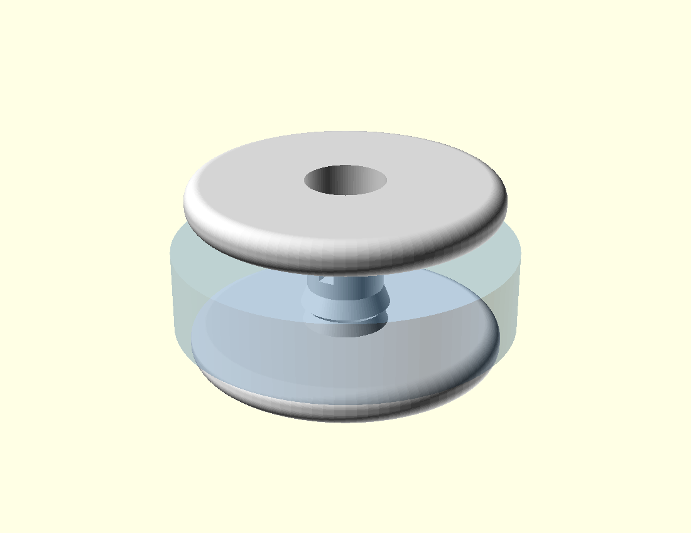
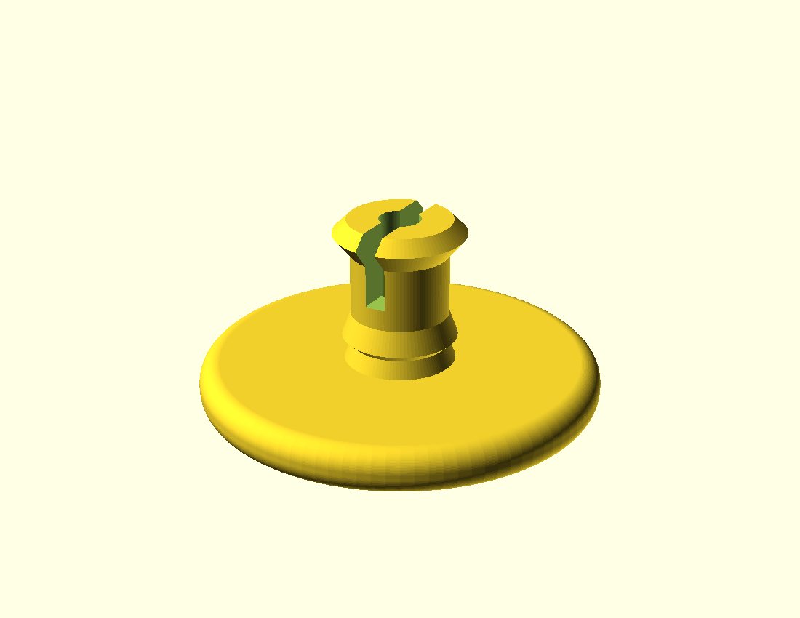
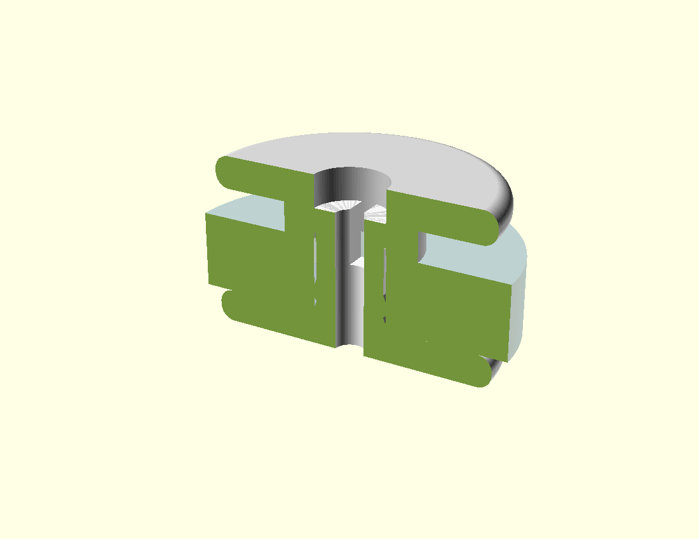
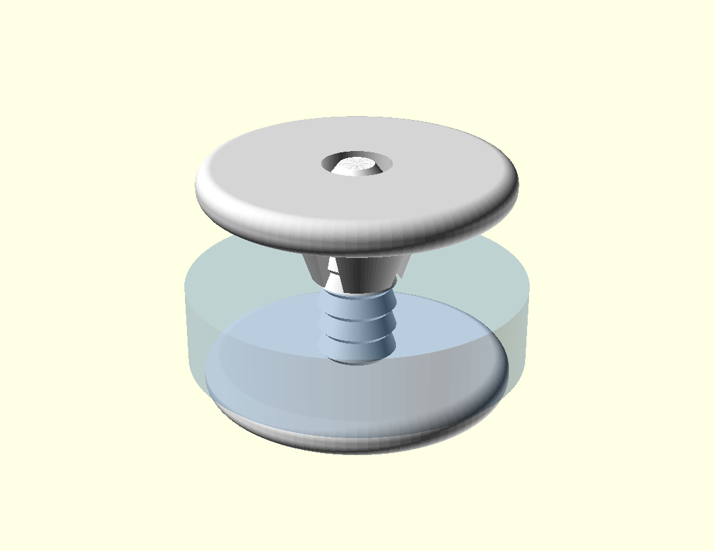
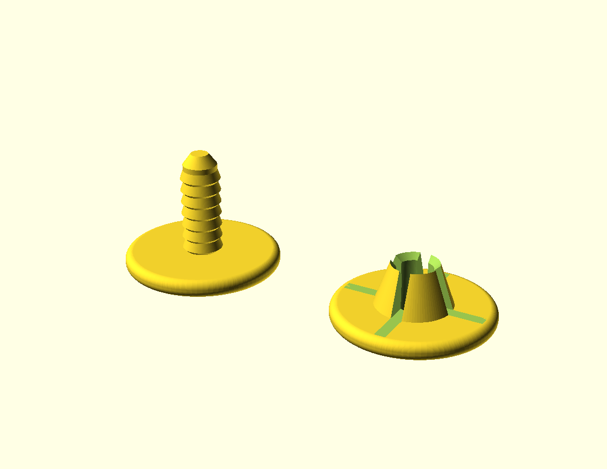
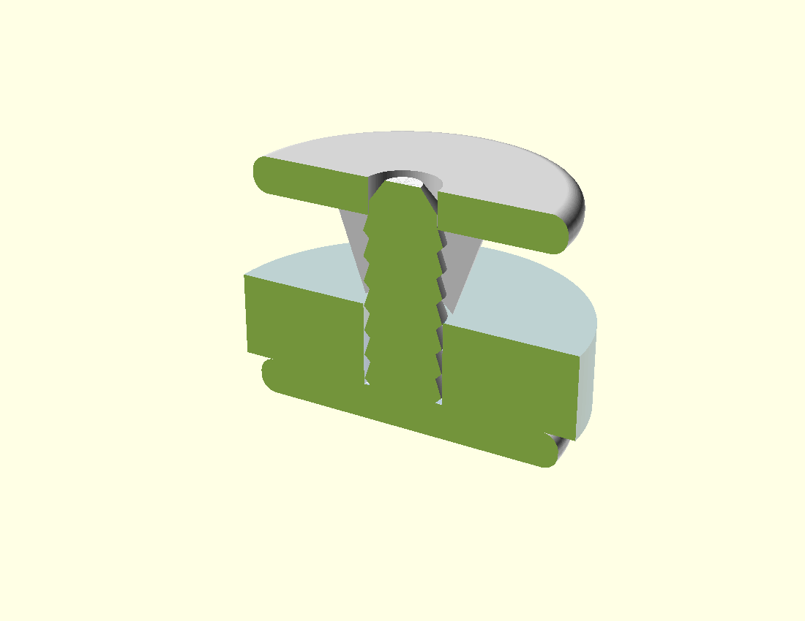

# Rivetti parametrici — OpenSCAD

Progetto di **rivetti in plastica a due parti**, completamente parametrici, generati con
[OpenSCAD](https://openscad.org) dal file [`rivetti.scad`](rivetti.scad).

Ogni rivetto è composto da due metà che, montate ai lati di un pannello, lo serrano tra le
due flange. Sono disponibili **due tipologie** selezionabili con il parametro `tipo`:

| Tipo | Descrizione | Riferimento |
|------|-------------|-------------|
| `scatto` | Bottoni a pressione: gambo con linguotti, campanatura e zigrinatura | [`img/rivetti-in-plastica-bottoni-a-pressione-3-mm-bianco.jpg`](img/rivetti-in-plastica-bottoni-a-pressione-3-mm-bianco.jpg) |
| `vite` | A perno dentato e mozzo a petali: si spinge e si blocca a scatto (ratchet) | [`img/rivetti2.webp`](img/rivetti2.webp) |

---

## Tipo `scatto` — bottoni a pressione



- **Maschio**: testa discoidale + gambo cavo con punta tagliata in 2 o 4 **linguotti**,
  **campanatura** di aggancio e denti di **zigrinatura**.
- **Femmina**: testa discoidale con colletto centrale forato e smussato.



### Come si blocca
Il gambo passa a pressione nel foro del pannello (lo zigrinatura lo frena), la punta
campanata si apre e scatta dietro la parte femmina. La trazione preme la campanatura
contro il foro: **non si sfila**.



## Tipo `vite` — a scatto ratchet (rif. foto 0–9 mm)



- **Maschio**: flangia + perno **dentato sull'intera lunghezza** (denti "a crichetto":
  rampa dolce verso la punta, faccia ripida verso la flangia) con punta rastremata
  d'avviamento.
- **Femmina**: flangia + mozzo bombato **fenduto in petali elastici**
  (2 o 4, parametro `tagli_mozzo`) con foro sotto la cresta dei denti.



### Come si blocca
**Non si avvita**: il perno si **spinge** nel mozzo, i petali si aprono e scattano di
dente in dente. Il serraggio si blocca a **qualsiasi spessore da 0 a 9 mm** (imposta
`spessore_pannello` e la lunghezza del perno si calcola da sola). La trazione preme sui
denti sulla faccia ripida → non si sfila; per smontare va forzato.



---

## Parametri principali

| Parametro | Default | Significato |
|-----------|---------|-------------|
| `tipo` | `"vite"` | `scatto` oppure `vite` |
| `parte` | `"assemblato"` | vista da generare: `maschio`, `femmina`, `assemblato`, `sezione`, `stampa` |
| `diametro_testa` | 11.5 | diametro della flangia |
| `spessore_testa` | 1.3 | spessore della flangia |
| `d_nominale` | 3 | a scatto: foro nel pannello — a vite: diametro nominale del perno (M3) |
| `spessore_pannello` | 3 | spessore del materiale tra le due flange (a vite: massimo aggrippabile) |
| `d_colletto` | 5.5 | diametro del colletto / mozzo |
| `h_colletto` | 1.2 | lunghezza del colletto (tipo scatto) |
| `h_mozzo_vite` | 3.2 | lunghezza del mozzo (tipo vite) |
| `tagli_mozzo` | 2 | petali del mozzo: 1 = due, 2 = quattro (tipo vite) |
| `qualita` | 96 | risoluzione degli archi (faccette) |

### Dettagli gambo (tipo scatto)
`gioco_gambo`, `sporgenza_punta`, `h_campana`, `espansione`, `smusso_punta`, `n_tagli`
(linguotti), `larghezza_taglio`, `h_taglio_extra`, `d_foro_gambo` (0 = gambo pieno),
`gioco_femmina`.

### Denti a pressione (entrambi i tipi)
`zigrinatura` (on/off), `d_sporgenza_denti` (sporgenza per lato: 0.1 scorrevole,
0.3 molto forzato), `d_passo_denti` (passo), `d_ripido_denti` (ripidezza della faccia
di ritenuta).

La **lunghezza del gambo/perno è automatica**:
`spessore_pannello + colletto/mozzo + flangia (+ sporgenza_punta)`.

## File generati

```
rivetti.scad                    modello parametrico
render/                         anteprime di tutte le viste
  rivetto-scatto-*.png          viste del tipo a scatto
  rivetto-vite-*.png            viste del tipo a vite
stl/
  rivetto-scatto-maschio.stl    parte maschio (a scatto)
  rivetto-scatto-femmina.stl    parte femmina (a scatto)
  rivetto-vite-maschio.stl      parte maschio (a perno dentato)
  rivetto-vite-femmina.stl      parte femmina (mozzo a petali)
```

## Stampa 3D

- Entrambe le parti si stampano **a flangia sul piatto** (vista `stampa`),
  **senza supporti**: il foro/dente della femmina si stampa in verticale.
- Materiale: **PETG o ABS** per l'elasticità dei linguotti/petali; PLA va bene
  per i prototipi.
- In caso di avvitamento/inserto duro o molle: regola `d_sporgenza_denti`
  e `d_passo_denti`, o alza `qualita` a 120–150.

## Uso

Apri `rivetti.scad` in OpenSCAD e usa il **customizer** (menu a tendina per `tipo`
e `parte`, slider per le misure), oppure da riga di comando:

```powershell
$osc = "C:\Users\debora.presti\Software\OpenSCAD\openscad.exe"

# STL del maschio tipo "vite" per un pannello da 6 mm
& $osc -o "stl\rivetto-vite-maschio.stl" -D 'tipo=\"vite\"' -D 'parte=\"maschio\"' -D 'spessore_pannello=6' rivetti.scad

# anteprima in sezione del tipo a scatto
& $osc -o "render\rivetto-scatto-sezione.png" --imgsize=1100,850 --autocenter --viewall `
    -D 'tipo=\"scatto\"' -D 'parte=\"sezione\"' rivetti.scad
```

## Varianti pronte all'uso

```openscad
flangia più piccola           ->  diametro_testa = 9.5;
perno pieno (scatto)          ->  d_foro_gambo = 0;
quattro linguotti (scatto)    ->  n_tagli = 2;
mozzo a 2 petali più rigido   ->  tagli_mozzo = 1;
zigrinatura morbida (scatto)  ->  d_sporgenza_denti = 0.15;
denti più mordenti (entrambi) ->  d_passo_denti = 0.7;  d_ripido_denti = 0.3;
```

> **Nota**: nella vista `sezione` i denti del perno sembrano "penetrare" i petali del
> mozzo: è normale — il modello è rigido, nella realtà i petali si flettono e li
> lasciano passare.
